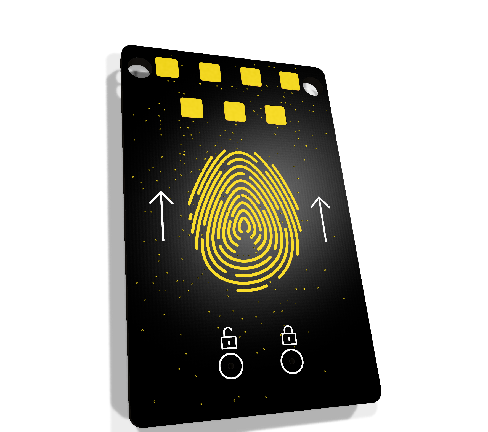
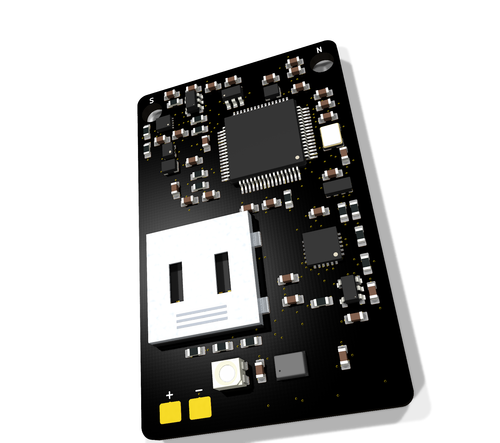
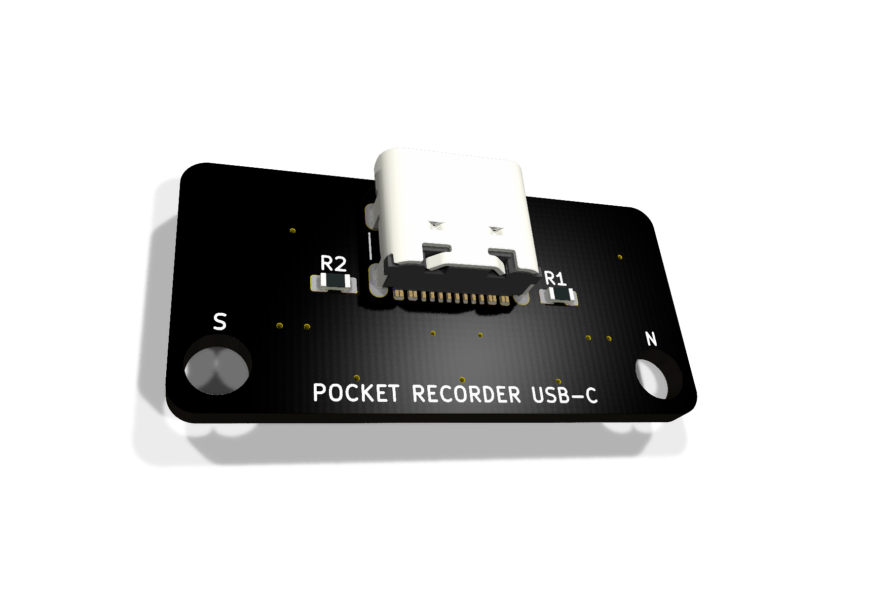
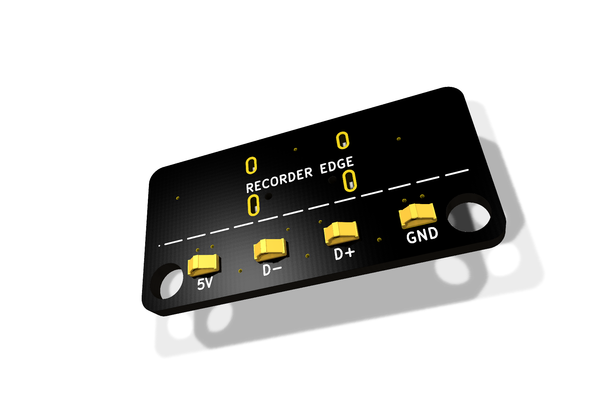

# Pocket Recorder + Magnetic USB-C Adapter — Hardware Release `v2.0.0`

Complete, verified, PCBWay-ready production files for **both boards**:
1. **Pocket Recorder Main Board (`v1.2.0`)** — 4-layer `30.0 × 48.0 mm` (`R1.5 mm`), `1.6 mm` Matte-Black ENIG, `0` ERC / `0` DRC / `0` unrouted.
2. **Magnetic Snap-On USB-C Adapter (`v1.0.0`)** — 2-layer `30.0 × 14.5 mm` (`R1.5 mm`), `1.6 mm` Matte-Black ENIG, `0.0000 mm` verified mating alignment, `0` ERC / `0` DRC / `0` unrouted.

---

## Board Renders

### 1. Pocket Recorder Main Board (4-Layer, 30.0 × 48.0 mm)
| Front (Outward Face) | Back (Parts Side) |
|---|---|
|  |  |

**Key Features (`v1.2.0`):**
- **MCU:** `STM32U595RJT6Q` (LQFP64, 1.8 V always-on SMPS, drop-in for `U5A5`/`U585`/`U575` Q)
- **Audio & Timekeeping:** TDK `MMICT5837-00-012` bottom-port PDM MEMS mic (`Ø0.60 mm` acoustic port, `Ø6.0 mm` bare-mask vent disc, `>= 31.5 mm` separation from all switchers) + Micro Crystal `RV-3032-C7` (±2.5 ppm RTC)
- **Storage:** **Molex `47219-2001` hinged clamshell microSD socket** (flip-open lid, zero slide-out clearance required) + switched 3.0 V LDO (`TLV75530`) + `TXS02612` level translator
- **Power:** `BQ25185DLHR` 250 mA linear power-path charger + `TPS62840` 60 nA Iq 1.8 V buck + bottom-edge `J_BAT` LiPo solder pads + USB-only 3.3 V LDO (`AP2112K-3.3`)
- **Outward Interface:** 7 bare ENIG gold `3.0 × 3.0 mm` pogo pads, ENIG gold thumbprint, minimalist white vector icons (flanking arrows, hole rings, unlock/lock icons), and **2× `Ø3.15 mm` N/S-keyed snap-fit magnet holes** (`Ø3.0 × 1.5 mm` N52 discs, flush)

---

### 2. Magnetic Snap-On USB-C Adapter (2-Layer, 30.0 × 14.5 mm)
| Top (USB-C Side) | Bottom (Mating Face) |
|---|---|
|  |  |

**Key Features (`v1.0.0`):**
- **USB-C Port:** `GCT USB4105-GF-A` 16-pin USB 2.0 receptacle with 4 through-hole shield legs overhanging past the main recorder edge + 2× `5.1 kΩ` CC1/CC2 pull-down resistors (`RC0603FR-075K1L`)
- **Compliant Low-Profile Contacts:** 4× **Harwin `S7241-45R`** gold-plated SMT spring fingers (`1.30 mm` free height → `1.00 mm` working height, `~40 gf` each, self-wiping) aligned to `TP_GND`, `TP_DP`, `TP_DM`, `TP_5V` within `0.0000 mm`
- **Zero-Air-Gap Magnetic Z-Stop:** 2× `Ø3.15 mm` NPTH holes for **`Ø3.0 × 2.5 mm` N52** magnets glued flush on the top (USB-C) face so they protrude `~0.9–1.0 mm` on the mating face, locking face-to-face with the recorder's magnets at `0 mm` air gap

---

## Included Production Files
Attach **`pocket_recorder_full_hardware_release_v2.0.0.zip`** (or the individual zips below):
- `01_pocket_recorder_4L/`: `pocket_recorder_pcbway_gerbers.zip`, unpacked Gerbers + separate `PTH.drl`/`NPTH.drl`, `pocket_recorder_bom.csv` (59 populated parts), `pocket_recorder_cpl.csv`, KiCad `.kicad_pro`/`.kicad_sch`/`.kicad_pcb`, custom 3D model, `verify_report.json`
- `02_usb_c_adapter_2L/`: `usb_adapter_pcbway_gerbers.zip`, unpacked Gerbers + separate `PTH.drl`/`NPTH.drl`, `usb_adapter_bom.csv` (7 populated parts), `usb_adapter_cpl.csv`, KiCad `.kicad_pro`/`.kicad_sch`/`.kicad_pcb`, custom 3D model
- `renders/`: High-resolution flat and isometric 3D renders of both faces of both boards

## PCBWay Fabrication Specs
| Setting | Main Recorder (`01_pocket_recorder_4L`) | USB-C Adapter (`02_usb_c_adapter_2L`) |
|---|---|---|
| Layers | **4-Layer** (`F.Cu / In1.Cu / In2.Cu / B.Cu`) | **2-Layer** (`F.Cu / B.Cu`) |
| Dimensions | `30.0 × 48.0 mm` (`R1.5 mm`) | `30.0 × 14.5 mm` (`R1.5 mm`) |
| Thickness | `1.6 mm` FR4 | `1.6 mm` FR4 |
| Surface Finish | **ENIG (Immersion Gold)** | **ENIG (Immersion Gold)** |
| Solder Mask | **Matte Black** (tented vias) | **Matte Black** (tented vias) |
| Silkscreen | White (`F.SilkS` icons + `B.SilkS`) | White (`F.SilkS` + `B.SilkS`) |
| Min Track / Space | `5 mil / 5 mil` (`0.127 mm`) | `6 mil / 6 mil` (`0.15 mm`) |
| Min Drill | `0.20 mm` (via), `0.60 mm` & `3.15 mm` NPTH | `0.25 mm` (via), `0.65 mm` & `3.15 mm` NPTH |
| Impedance Control | `90 Ω` diff pair on `USB_DP`/`USB_DM` (`In2.Cu` ref `In1.Cu`) | Not required (`~6 mm` trace) |
